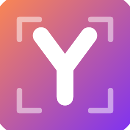

<p align="center">
  
</p>

<h1 align="center">YEDIT</h1>

<p align="center">
  A native, open-source image editor written in Rust, with Photoshop-style layers, masks,
  adjustment layers, type, vectors and real PSD files. Every action is a command an agent can run.
</p>

YEDIT is FESI Labs' fork of [PhotoCraft](https://github.com/storytold/photocraft), by the ArtCraft
team. It is not made, sponsored or endorsed by them. See [NOTICE](NOTICE) for what changed.

## Features

- **Layers and adjustments:** groups, masks, smart objects and 16 non-destructive adjustment
  layers (Curves, Levels, Vibrance, ...); layer styles (shadows, glows, bevel and emboss, strokes,
  overlays).
- **Selections:** marquee, lasso, magic wand and an on-device Select Subject.
- **Type and vectors:** editable type layers, shape layers and the Pen tool family.
- **Files:** opens and saves layered PSD/PSB, plus TIFF, OpenRaster, GIMP XCF, Krita, HEIC (read),
  camera raws and more. The lossless native format is `.yedit`.
- **Colour:** RGB, Grayscale, CMYK and Lab at 8, 16 and 32 bits per channel, ICC managed.
- **Native and fast:** egui on wgpu (DX12, Vulkan, Metal), no Electron; the same code builds for
  the browser as WebAssembly.

## Tools

<h4>67 tools</h4>
Move · Artboard · Rectangular and Elliptical Marquee · Single Row Marquee · Single Column Marquee · Lasso · Polygonal Lasso · Magnetic Lasso · Object Selection · Quick Selection · Magic Wand · Crop · Perspective Crop · Slice · Slice Select · Frame · Eyedropper · Color Sampler · Ruler · Note · Count · Remove · Spot Healing Brush · Healing Brush · Patch · Content-Aware Move · Red Eye · Brush · Pencil · Mixer Brush · Color Replacement · Clone Stamp · Pattern Stamp · History Brush · Eraser · Background Eraser · Magic Eraser · Gradient · Paint Bucket · Blur · Sharpen · Smudge · Dodge · Burn · Sponge · Pen · Freeform Pen · Curvature Pen · Add Anchor Point · Delete Anchor Point · Convert Point · Horizontal and Vertical Type · Horizontal and Vertical Type Mask · Path Selection · Direct Selection · Rectangle · Ellipse · Triangle · Polygon · Line · Custom Shape · Hand · Rotate View · Zoom


## Built for agents

Every menu item, tool and dialog runs a command from one registry of 500+ commands. The UI, the
CLI, the JSON control channel and the MCP server all call the same commands.

```sh
# Headless: open, edit, save
yedit-cli run wave.psd \
  --cmd filter.sharpen.smartSharpen     --params '{"amount":80}' \
  --cmd layer.newAdjustmentLayer.curves --params '{"points":[[0,0],[64,48],[192,212],[255,255]]}' \
  --out wave-final.png

# Apply one action list to a folder of images
yedit-cli batch --actions grade.json --in ./raw --out ./graded

# Let an agent drive it over MCP (headless, or bridged to the running app)
yedit-cli mcp
```

The desktop app also offers an authenticated, loopback-only control channel (`yedit --control`)
for inspecting UI state, driving tools and taking offscreen screenshots. See
[`docs/control-protocol.md`](docs/control-protocol.md).

## Build and run

Needs Rust 1.95 or newer; on Windows also the Visual Studio C++ Build Tools.

```sh
cargo run --release -p yedit -- image.psd   # the desktop app
cargo run --release -p yedit-cli -- --help  # the headless CLI
cargo test --workspace                      # the test suite
```

Japanese UI and Type fonts are an optional build input,
[craft-fonts](https://github.com/storytold/craft-fonts):
`CRAFT_FONTS_DIR="$PWD/../craft-fonts" cargo run --release -p yedit`.

The app icon is regenerated from `assets/app-icon/yedit.svg` by `packaging/icons.sh` (needs
`resvg`). The rename from PhotoCraft was done by `scripts/rebrand-yedit.sh` plus hand edits.

## Documentation

Architecture, development, the control protocol and the user guide are in [`docs/`](docs/) and
[`book/`](book/). They come from upstream and still describe its process (releases, signing,
community) in places.

## License and credits

YEDIT is dual-licensed under [MIT](LICENSE-MIT) or [Apache-2.0](LICENSE-APACHE), at your option.
Copyright (c) 2026 FESI Labs; the code it is based on is Copyright (c) 2026 ArtCraft Team and the
PhotoCraft contributors. Required notices are in [NOTICE](NOTICE).

Bundled fonts, icons, images and other assets keep their own open licenses; each one is listed
with its author, source and license in [ATTRIBUTION.md](ATTRIBUTION.md).

<sub>Adobe and Photoshop are trademarks or registered trademarks of Adobe Inc. in the United
States and/or other countries. YEDIT is an independent project and is not affiliated with,
sponsored by or endorsed by Adobe Inc.; these names are used only to describe the workflows it is
compatible with.</sub>
